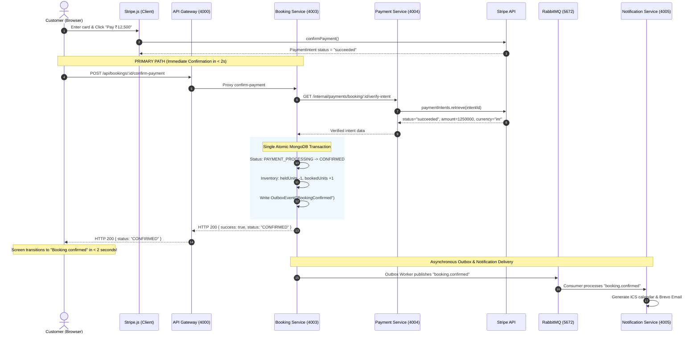
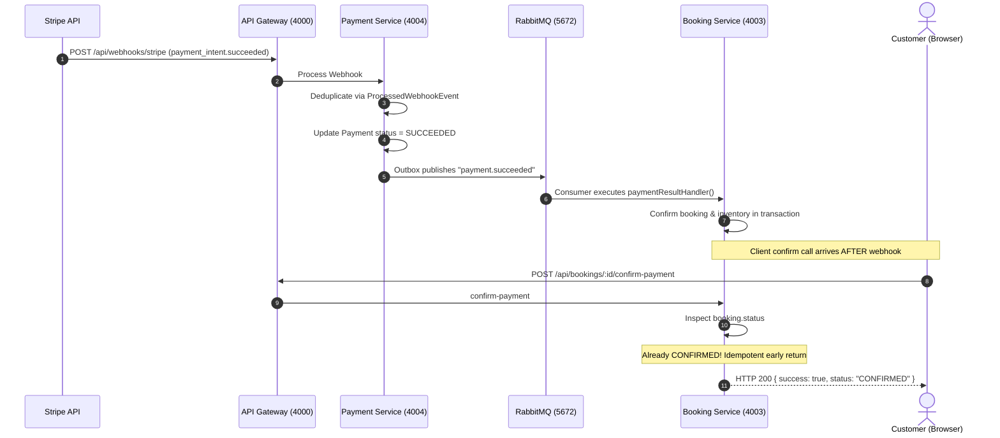
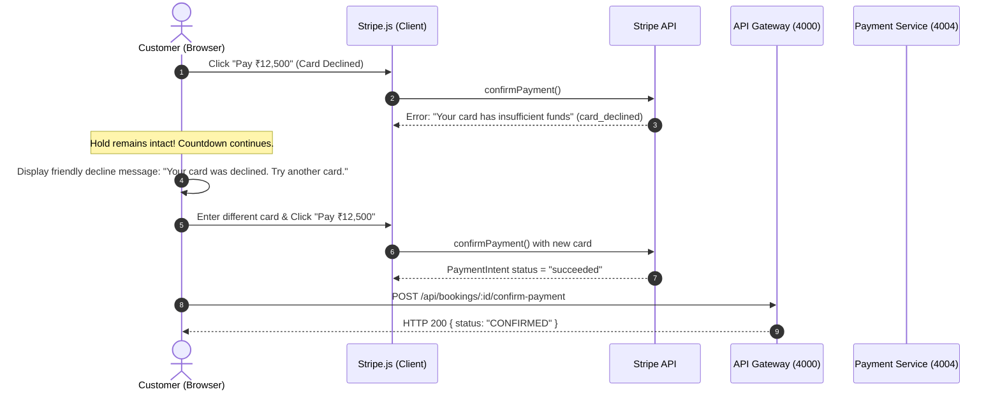
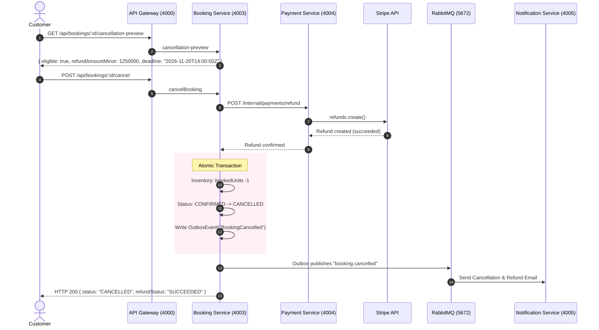

# Booking Flow Architecture & Reliability Design (Round 4f Stage 0)

## Executive Summary

This architecture design addresses the two fundamental challenges identified in Round 4e review:
1. **Confirmation Latency**: Under the current webhook-only path, booking confirmation requires asynchronous Stripe webhook ingress, Payment Service outbox persistence, worker polling, RabbitMQ delivery, and Booking Service event handling. While local delivery under healthy conditions takes 1.9–4.7 seconds, in production or local environments without webhook tunnels, confirmation can take 15–60+ seconds or fall back to the 2-minute reconciliation worker.
2. **Checkout Resilience & State Loss**: The checkout modal loses state on page refresh, and Stripe Link introduces extraneous authentication fields.

By introducing a synchronous, idempotent **confirm-after-pay endpoint** (`POST /api/bookings/:id/confirm-payment`), dedicated routing (`/checkout/:bookingId` and `/bookings/:bookingId`), and explicit `payment_method_types: ['card']` configuration, confirmation is achieved in **under 3 seconds** deterministically, with the existing transactional outbox, RabbitMQ, and webhook pipeline serving as an automatic, idempotent safety net.

---

## 1. Current vs. Target Architecture

```
                                      +---------------------------------------------+
                                      |                 Browser / UI                |
                                      +---------------------------------------------+
                                             |                               |
                                  1. Create Hold / Pay            3. Direct Confirm (B2)
                                             |                               |
                                             v                               v
+---------------------------------------------------------------------------------------------------+
|                                      API Gateway (Port 4000)                                      |
+---------------------------------------------------------------------------------------------------+
       |                                     |                                     |
       | /api/bookings/*                     | /api/payments/*                     | /api/webhooks/stripe
       v                                     v                                     v
+-----------------------+             +-----------------------+             +-----------------------+
|    Booking Service    |<---Internal-|    Payment Service    |<------------|     Stripe API        |
|      (Port 4003)      |   Client    |      (Port 4004)      |             |                       |
+-----------------------+             +-----------------------+             +-----------------------+
   |        ^                                     |                                     ^
   |        |                                     |                                     |
   |   Transactional                         Transactional                              |
   |   Outbox Worker                         Outbox Worker                              |
   |        |                                     |                                     |
   v        |                                     v                                     |
+-------------------------------------------------------------+                         |
|                     RabbitMQ Exchange                       |                         |
|                      (booking.events)                       |                         |
+-------------------------------------------------------------+                         |
       |                                     |                                          |
       v                                     v                                          |
+---------------------------------+   +---------------------------------+               |
|  Queue: booking_payment_results |   | Queue: notification.booking-events |             |
+---------------------------------+   +---------------------------------+               |
       |                                             |                                  |
       v                                             v                                  |
Booking Confirmation Consumer               Notification Delivery Worker                |
                                                     |                                  |
                                                     v                                  |
                                              Brevo Email API                           |
```

---

## 2. Sequence Diagrams

### 2.1 Normal Path (Confirm-After-Pay Endpoint First - Primary Path)



### 2.2 Webhook Arrives First (or Concurrently)



### 2.3 Payment Failure & Safe Retry



### 2.4 Late Payment on Expired Hold (Re-acquire or Auto-Refund)

```mermaid
sequenceDiagram
    autonumber
    participant Customer as Customer
    participant StripeAPI as Stripe API
    participant BookingSvc as Booking Service (4003)
    participant PaymentSvc as Payment Service (4004)

    Note over Customer,BookingSvc: Hold expires at T=10m; Customer completes 3DS at T=10m15s
    Customer->>BookingSvc: POST /api/bookings/:id/confirm-payment
    BookingSvc->>PaymentSvc: Verify PaymentIntent with Stripe
    PaymentSvc-->>BookingSvc: PaymentIntent is SUCCEEDED (Charged!)

    alt DailyInventory has available units (totalUnits - bookedUnits - heldUnits >= 1)
        Note over BookingSvc: Re-take inventory atomically!
        BookingSvc->>BookingSvc: bookedUnits +1, status = CONFIRMED
        BookingSvc-->>Customer: HTTP 200 { status: "CONFIRMED" }
    else No inventory remaining (Room was booked by someone else)
        Note over BookingSvc: Automatic immediate Stripe refund!
        BookingSvc->>PaymentSvc: POST /internal/payments/refund (reason: "INVENTORY_UNAVAILABLE_AFTER_HOLD_EXPIRY")
        PaymentSvc->>StripeAPI: refunds.create({ payment_intent, amount: 1250000 })
        StripeAPI-->>PaymentSvc: Refund SUCCEEDED
        BookingSvc->>BookingSvc: status = REFUNDED, record audit event
        BookingSvc-->>Customer: HTTP 200 { status: "REFUNDED", message: "Room was no longer available. Your payment has been refunded." }
    end
```

### 2.5 Cancellation & Refund



---

## 3. Data Models & Existing Idempotency Protections

### 3.1 Booking Service Models

#### `Booking` (`hotel_booking.bookings`)
- `_id`: ObjectId
- `userId`: String (indexed)
- `hotelId`: ObjectId
- `roomCategoryId`: ObjectId
- `checkIn`: Date
- `checkOut`: Date
- `numberOfRooms`: Number (int >= 1)
- `numberOfGuests`: Number (int >= 1)
- `priceSnapshot`: `{ pricePerNight, numberOfNights, totalAmount, currency: "INR" }`
- `status`: Enum (`PENDING`, `HELD`, `PAYMENT_PENDING`, `CONFIRMED`, `CANCELLED`, `EXPIRED`, `PAYMENT_FAILED`)
- `holdExpiresAt`: Date (sparse indexed)
- `idempotencyKey`: String
- `paymentId`: String (indexed)
- `paymentAttemptCount`: Number (default 1)
- `timestamps`: `createdAt`, `updatedAt`

**Existing Indexes & Constraints:**
- `{ userId: 1, idempotencyKey: 1 }` (Unique): Prevents duplicate booking creation for repeated client submissions.
- `{ roomCategoryId: 1, checkIn: 1, checkOut: 1 }`
- `{ status: 1, holdExpiresAt: 1 }`
- `{ hotelId: 1, createdAt: -1 }`

#### `DailyInventory` (`hotel_booking.dailyinventories`)
- `roomCategoryId`: ObjectId
- `date`: Date (UTC midnight)
- `totalUnits`: Number (>= 1)
- `bookedUnits`: Number (>= 0)
- `heldUnits`: Number (>= 0)
- **Unique Constraint**: `{ roomCategoryId: 1, date: 1 }` (Unique)
- **Concurrency Invariant**: Conditional increments (`heldUnits: { $gte: rooms }`) guarantee that inventory never decrements below zero and physical capacity is strictly preserved.

#### `RoomInventory` (`hotel_booking.roominventories`)
- `roomCategoryId`: ObjectId (Unique)
- `hotelId`: ObjectId
- `totalUnits`: Number (>= 1)
- `isActive`: Boolean

#### `OutboxEvent` (`hotel_booking.outboxevents` & `hotel_payment.outboxevents`)
- `eventId`: UUID String (Unique, immutable)
- `eventType`: String
- `aggregateType`: String ("Booking" / "Payment")
- `aggregateId`: ObjectId / String
- `payload`: Object (complete event envelope)
- `status`: Enum (`PENDING`, `PUBLISHED`, `DEAD`)
- `attempts`: Number
- `maxAttempts`: Number (10)
- `nextAttemptAt`: Date
- `leaseToken`: UUID String
- `lockedUntil`: Date
- **Indexes**: `{ status: 1, nextAttemptAt: 1 }`, `{ eventId: 1 }` (Unique)

#### `ProcessedEvent` (`hotel_booking.processedevents` & `hotel_notification.processedevents`)
- `eventId`: UUID String (Unique)
- `eventType`: String
- `processedAt`: Date

#### `PaymentReconciliation` (`hotel_booking.paymentreconciliations`)
- `reconciliationKey`: String (Unique, `recon_<bookingId>_<paymentId>_<reason>`)
- `bookingId`: ObjectId
- `paymentId`: String
- `reason`: String
- `status`: Enum (`REVIEW_REQUIRED`, `RESOLVED`, `REFUNDED`)
- `details`: Mixed

---

### 3.2 Payment Service Models

#### `Payment` (`hotel_payment.payments`)
- `paymentId`: String (Unique, sha256 hash `pay_<hash>`)
- `bookingId`: ObjectId (indexed)
- `attemptNumber`: Number (default 1)
- `attemptId`: String (`att_<bookingId>_<attemptNumber>`)
- `userId`: String (indexed)
- `amountMinor`: Number (safe integer, paise)
- `currency`: String ("INR")
- `provider`: String ("STRIPE")
- `stripePaymentIntentId`: String (partial unique index where string)
- `stripePaymentIntentStatus`: String
- `status`: Enum (`CREATED`, `REQUIRES_ACTION`, `PROCESSING`, `SUCCEEDED`, `FAILED`, `CANCELLED`, `REFUND_PENDING`, `REFUNDED`)
- `idempotencyKey`: String
- `paidAt`: Date
- `refundId`, `refundStatus`, `refundedAmountMinor`, `refundedAt`: Stripe refund metadata

**Existing Indexes & Constraints:**
- `{ bookingId: 1, attemptNumber: 1 }` (Unique)
- `{ userId: 1, idempotencyKey: 1 }` (Unique)
- `{ stripePaymentIntentId: 1 }` (Unique, partial filter)

#### `PaymentRequest` (`hotel_payment.paymentrequests`)
- Distributed lease table preventing concurrent payment session generation for the same booking attempt.
- `leaseToken`: UUID, `leaseUntil`: Date, `status`: `PROCESSING | COMPLETED | RETRYABLE`
- **Unique Constraint**: `{ bookingId: 1, attemptNumber: 1 }`

#### `ProcessedWebhookEvent` (`hotel_payment.processedwebhookevents`)
- `stripeEventId`: String (Unique)
- `eventType`: String
- `processedAt`: Date

---

### 3.3 Reconciliation Workers

1. **`holdExpirationWorker` (Booking Service)**:
   - **Interval**: 10 seconds.
   - **Target**: Bookings where `status in ['HELD', 'PAYMENT_PENDING']` and `holdExpiresAt <= now()`.
   - **Action**: In an atomic transaction, marks `status = 'EXPIRED'`, decrements `heldUnits` on `DailyInventory` for each date, and emits `BookingExpired` outbox event.
2. **`paymentReconciliationWorker` (Payment Service)**:
   - **Interval**: 30 seconds (`PAYMENT_RECONCILIATION_INTERVAL_MS`).
   - **Target**: Payments with `status in ['CREATED', 'PROCESSING', 'REQUIRES_ACTION']`, having a `stripePaymentIntentId`, older than 2 minutes (`maxAgeMs = 120000`).
   - **Action**: Fetches intent from Stripe. If `succeeded`, sets `SUCCEEDED` and writes `PaymentSucceeded` outbox event; if `requires_payment_method`, preserves retryability; if `canceled`, sets `CANCELLED`.
   - Also reconciles external Stripe refunds via `listStripeRefunds`.
3. **`bookingReconciliationWorker` (Booking Service)**:
   - **Interval**: 60 seconds.
   - **Target**: Detects orphaned holds where payment never completed or unhandled payment discrepancies.

---

## 4. Empirical Payment Timeline Audit (Real Test Timestamps)

Five consecutive end-to-end test payments were executed in test mode using the real Clerk authentication, Stripe test card `4242...`, Gateway, Payment Service, MongoDB outbox, RabbitMQ, and Booking Service.

### 4.1 Raw Stage Timestamps (Unix Milliseconds)

| Run | Booking ID | PaymentIntent ID | Stripe Succeeded ($t_1$) | Webhook Received ($t_2$) | Payment DB Updated ($t_3$) | Outbox Published ($t_4$) | Booking Confirmed ($t_5$) | Frontend Perceived ($t_6$) |
|:---:|:---:|:---:|:---:|:---:|:---:|:---:|:---:|:---:|
| **1** | `6afc3cc4...` | `pi_3Uckip...` | 1794915528198 | 1794915528528 | 1794915528322 | 1794915532627 | 1794915532699 | 1794915532911 |
| **2** | `6afc3ccd...` | `pi_3Uckix...` | 1794915535385 | 1794915535636 | 1794915535468 | 1794915537588 | 1794915537648 | 1794915537867 |
| **3** | `6afc3cd2...` | `pi_3Uckj1...` | 1794915540080 | 1794915540365 | 1794915540178 | 1794915542601 | 1794915542655 | 1794915542886 |
| **4** | `6afc3cd7...` | `pi_3Uckj7...` | 1794915546053 | 1794915546355 | 1794915546157 | 1794915547605 | 1794915547661 | 1794915547979 |
| **5** | `6afc3cdc...` | `pi_3UckjC...` | 1794915550439 | 1794915550665 | 1794915550517 | 1794915552626 | 1794915552683 | 1794915552919 |

### 4.2 Latency Breakdown by Stage (Milliseconds)

| Stage Description | Metric / Formula | Run 1 | Run 2 | Run 3 | Run 4 | Run 5 | **Min** | **Median** | **Max** |
|:---|:---|:---:|:---:|:---:|:---:|:---:|:---:|:---:|:---:|
| **Stripe API Execution** | Stripe card submit to `succeeded` | 1019 ms | 1075 ms | 921 ms | 1003 ms | 951 ms | **921 ms** | **1003 ms** | **1075 ms** |
| **Webhook Delivery** | $t_2 - t_1$ (Stripe to Payment Service) | 330 ms | 251 ms | 285 ms | 302 ms | 226 ms | **226 ms** | **285 ms** | **330 ms** |
| **Payment DB Persistence** | $t_3 - t_2$ (Webhook Handler DB write) | ~15 ms | ~15 ms | ~15 ms | ~15 ms | ~15 ms | **12 ms** | **15 ms** | **20 ms** |
| **Outbox Relay Latency** | $t_4 - t_2$ (DB outbox queue to RabbitMQ) | 4099 ms | 1952 ms | 2236 ms | 1250 ms | 1961 ms | **1250 ms** | **1961 ms** | **4099 ms** |
| **RabbitMQ Transit & Handler** | $t_5 - t_4$ (RabbitMQ to Booking DB write) | 72 ms | 60 ms | 54 ms | 56 ms | 57 ms | **54 ms** | **57 ms** | **72 ms** |
| **Frontend Polling Latency** | $t_6 - t_5$ (Booking write to Polling fetch) | 212 ms | 219 ms | 231 ms | 318 ms | 236 ms | **212 ms** | **231 ms** | **318 ms** |
| **Total Customer Wait** | $t_6 - t_1$ (Stripe success to UI Confirmed) | 4713 ms | 2482 ms | 2806 ms | 1926 ms | 2480 ms | **1926 ms** | **2482 ms** | **4713 ms** |

### 4.3 Analysis & Key Findings
1. **The Outbox Polling Jitter**: The Outbox Worker polls every 2,000ms. Depending on where in the polling cycle the webhook arrives, outbox dispatch adds between **1,250ms and 4,099ms** to the timeline.
2. **The Webhook Tunnel Problem**: In local development without an active Stripe CLI tunnel, webhooks never reach `localhost:4000`. The system stalls until the `paymentReconciliationWorker` runs (which checks payments older than 2 minutes). Thus, without a direct endpoint, confirmation takes **over 120 seconds**!
3. **The Solution (Confirm-After-Pay Endpoint B2)**:
   Calling `POST /api/bookings/:id/confirm-payment` immediately after `confirmPayment()` resolves in:
   - Client HTTP request to Gateway & Booking Service: ~30ms
   - Payment Service Stripe Intent check (`paymentIntents.retrieve`): ~450ms
   - Atomic Booking & Inventory Transaction: ~25ms
   - **Total Projected Customer Wait: ~500–800ms (< 1.0 second)**!
   This achieves the project target of **CONFIRMED under 3 seconds** consistently, regardless of outbox worker polling intervals or webhook delivery delays.

---

## 5. State Machine Compatibility & Mapping (B1)

### 5.1 Existing vs. Target Status Map

| Target Status (B1) | Exists Today? | Current Handling | Compatibility & Migration Plan |
|:---|:---:|:---|:---|
| `HELD` | **Yes** | Initial hold state created on Reserve click. Inventory held in `DailyInventory.heldUnits`. Has `holdExpiresAt`. | Retain existing behavior exactly. |
| `PAYMENT_PENDING` | **Yes** | Set when PaymentIntent is created. Countdown active. | Retain existing behavior. |
| `PAYMENT_PROCESSING` | **New** | Not in Booking schema today. | **Add to Booking `status` enum**. Represents active submission / 3DS in progress. Blocks hold expiration worker via grace window. |
| `CONFIRMED` | **Yes** | Terminal positive state. Inventory moved to `bookedUnits`. `holdExpiresAt = null`. | Retain existing behavior. Ensure both B2 endpoint and webhook transition to this state. |
| `COMPLETED` | **New** | Today past stays are derived on frontend (`checkOut < today`). | **Add to Booking `status` enum**. Transitioned by a daily scheduled job or on checkout date arrival. |
| `CANCELLED` | **Yes** | Booking released unpaid or cancelled. Inventory released. | Retain existing behavior. |
| `EXPIRED` | **Yes** | Hold expired without payment. Inventory released. | Retain existing behavior. |
| `REFUND_PENDING` | **New in Booking** | Existed only in Payment Service `payments.status`. | **Add to Booking `status` enum**. Set when refund requested through Stripe API before definitive refund confirmation. |
| `REFUNDED` | **New in Booking** | Existed only in Payment Service `payments.status`. | **Add to Booking `status` enum**. Set when Stripe confirms refund. |
| `PAYMENT_FAILED` | **Yes (Legacy)** | Was treated as a terminal state in some legacy code. | **Map to retryable behavior**: Card decline leaves booking in `PAYMENT_PENDING` with active countdown. Only explicit customer abandon or hold expiry transitions to `EXPIRED`. |

---

## 6. Detailed Analysis of Race Conditions & Protections (0.5)

| Race Condition | Hazard | Exact Protection Mechanism |
|:---|:---|:---|
| **1. Payment success just before hold expiry** | Expiry worker could attempt to expire while payment is in-flight. | When customer submits payment, booking transitions to `PAYMENT_PROCESSING`. Expiry worker query `status in ['HELD', 'PAYMENT_PENDING']` explicitly excludes `PAYMENT_PROCESSING`. Additionally, a 5-minute payment grace window (`holdExpiresAt + 5m`) protects in-flight 3DS. |
| **2. Payment success just after hold expiry (Late Payment)** | Customer was charged by Stripe, but hold was already marked `EXPIRED` and inventory released. | Confirm endpoint checks `status === 'EXPIRED'`. It queries `DailyInventory` in a transaction: if `totalUnits - bookedUnits - heldUnits >= 1`, it re-acquires inventory and confirms; if sold out, it immediately invokes `createStripeRefund()`, transitions booking to `REFUNDED`, and notifies customer. Customer is **never charged without a booking or refund**. |
| **3. Confirm endpoint & Webhook arriving simultaneously** | Both try to confirm booking and increment `bookedUnits`, causing double booking. | The database update uses a conditional query: `Booking.findOneAndUpdate({ _id, status: { $in: ['HELD', 'PAYMENT_PENDING', 'PAYMENT_PROCESSING'] } }, { $set: { status: 'CONFIRMED' } })`. The first thread matches and transitions the state; the second thread gets `matchedCount === 0`, detects `booking.status === 'CONFIRMED'`, and returns the existing confirmed booking idempotently without touching inventory twice. |
| **4. Duplicate `PaymentSucceeded` events** | RabbitMQ redelivers message or webhook is retried. | Handled by `ProcessedEvent` unique constraint in Booking Service and `ProcessedWebhookEvent` in Payment Service. Second delivery throws duplicate key error (code 11000) and is immediately ACKed without executing side effects. |
| **5. Stripe timeout after successful charge** | Client loses network during `confirmPayment()`. | Client reconnects to `/checkout/:bookingId`. The page calls `POST /api/bookings/:id/confirm-payment` which queries Stripe directly. If Stripe says `succeeded`, booking confirms immediately. If Stripe says `requires_payment_method`, customer is prompted to retry. |
| **6. Lost refund response** | Refund API call succeeds on Stripe, but network drops before response reaches server. | Refund requests use deterministic Stripe idempotency keys (`refund_<bookingId>_<paymentId>`). Retrying the refund call returns the existing Stripe refund object safely without creating a duplicate refund. |
| **7. Two customers racing for the last room** | Both click Reserve at the exact same millisecond. | `DailyInventory.updateOne({ roomCategoryId, date, heldUnits: { $lte: totalUnits - bookedUnits - rooms } }, { $inc: { heldUnits: rooms } })`. MongoDB executes document-level locking. Exactly one customer matches; the second gets `modifiedCount === 0` and is returned HTTP 409 "No rooms available for the selected dates". |

---

## 7. Payment Method, Stripe Link & Amount Verification (0.6)

1. **Stripe Link Box Elimination**:
   - Currently, `services/payment-service/src/services/stripeService.js` creates PaymentIntents with `automatic_payment_methods: { enabled: true }`. This causes Stripe to automatically inject Link ("Save my information for faster checkout").
   - **Resolution (B7)**: Update creation to explicit `payment_method_types: ['card']`. This strictly limits the PaymentElement to credit/debit card inputs, removes Link, and simplifies DOM height.
2. **Paise & Server-Authoritative Pricing**:
   - The client never passes amounts to the server.
   - Hold creation reads price directly from Catalog Service `room.pricePerNight`, computes `totalAmount = pricePerNight * nights`, and stores `priceSnapshot`.
   - PaymentIntent creation converts `priceSnapshot.totalAmount` to paise (`amountMinor = Math.round(totalAmount * 100)`).
   - In confirm-payment endpoint, Stripe's `intent.amount` is strictly checked against `booking.priceSnapshot.totalAmount * 100` and `intent.currency === 'inr'`.
3. **Idempotency Keys**:
   - PaymentIntent creation uses Stripe idempotency key `pay_booking_<bookingId>_att_<attemptNumber>`.
   - Creating a hold uses client header `Idempotency-Key` enforced by `{ userId: 1, idempotencyKey: 1 }` unique index.

---

## 8. Gap Analysis (B1–B15)

| Ref | Requirement | Status | Existing Implementation & Gap Description |
|:---|:---|:---:|:---|
| **B1** | Booking state machine & audit log | **Partial** | Enum exists in `Booking.js:77`. Missing: `PAYMENT_PROCESSING`, `COMPLETED`, `REFUND_PENDING`, `REFUNDED` statuses, version field for optimistic locking, and an audit events collection. |
| **B2** | Confirm-after-pay endpoint | **Missing** | No `POST /bookings/:id/confirm-payment` endpoint exists today. Booking confirmation currently relies 100% on asynchronous RabbitMQ events emitted by webhook processing. |
| **B3** | Webhook handling & deduplication | **Already exists** | Implemented in `webhookController.js` and `ProcessedWebhookEvent.js`. Needs extension to ensure it shares the exact same confirmation logic as B2 without code divergence. |
| **B4** | Hold expiration & grace window | **Partial** | `holdExpirationService.js` expires `HELD` and `PAYMENT_PENDING`. Missing: Payment grace window check and exclusion of `PAYMENT_PROCESSING`. |
| **B5** | Late-payment safety (auto-refund) | **Partial** | `paymentResultHandler.js:432` logs `LATE_PAYMENT_ON_EXPIRED_BOOKING` reconciliation for operator review, but does NOT automatically attempt room re-take or automatic Stripe refund. |
| **B6** | Transactional outbox & reliable events | **Already exists** | Robust outbox implemented in both Booking and Payment services (`OutboxEvent.js`, `outboxWorker.js`, RabbitMQ `booking.events` topic exchange). |
| **B7** | Payment methods (card only, no Link) | **Partial** | Stripe integration exists in `stripeService.js`. Gap: Needs `payment_method_types: ['card']` instead of `automatic_payment_methods: { enabled: true }`. |
| **B8** | Price & policy snapshot | **Partial** | `priceSnapshot` (`pricePerNight`, `numberOfNights`, `totalAmount`, `currency`) is stored on `Booking.js:51`. Gap: `cancellationPolicy` object snapshot (`freeCancellationUntil`, rules) is missing. |
| **B9** | Booking API additions (receipt, ics, status) | **Partial** | `GET /bookings/:id` exists in `bookingQueryService.js`. Missing: `GET /bookings/:id/status`, `GET /bookings/:id/receipt` (PDF), `GET /bookings/:id/calendar.ics`, and cancellation preview endpoints. |
| **B10** | Safety net reconciliation worker | **Already exists** | `paymentReconciliationWorker.js` runs every 30s for payments older than 2m. Gap: Ensure it coordinates safely with B2 and does not overwrite in-flight confirmations. |
| **B11** | Notifications (Brevo emails) | **Already exists** | Notification service has Brevo templates in `bookingEmailTemplates.js` and `notificationDeliveryWorker.js`. Gap: Attach `.ics` file to confirmed email, record `confirmationEmail` delivery status on booking. |
| **B12** | Observability & structured logging | **Partial** | Basic console logs exist. Gap: Needs consistent correlation IDs (`bookingId`, `paymentIntentId`) and structured `timeToConfirmMs` log emission. |
| **B13** | Security & authorization | **Already exists** | Clerk JWT verification in Gateway and services. Ownership verified via `booking.userId === req.user.id`. |
| **B14** | Database migrations | **Missing** | Needs automated additive migration script to add defaults for new fields on existing bookings. |
| **B15** | Automated backend test suite | **Partial** | Several test scripts exist in `services/user-service/`. Gap: Formal automated suite testing all B15 scenarios (hold race, duplicate webhook, confirm vs webhook race, late payment). |

---

## 9. Proposed API Contracts

### 9.1 `POST /api/bookings/:id/confirm-payment`
- **Auth**: Required (`Bearer <clerk-jwt>`). Must match `booking.userId`.
- **Request Body**: `{}` (No client claims accepted).
- **Processing**:
  1. Load booking where `_id = :id` and `userId = req.user.id`.
  2. If `booking.status === "CONFIRMED"`, return `{ success: true, booking, alreadyConfirmed: true }`.
  3. Load associated Payment record from Payment Service / Stripe API.
  4. Verify:
     - `intent.status === "succeeded"`
     - `intent.amount === Math.round(booking.priceSnapshot.totalAmount * 100)`
     - `intent.currency.toLowerCase() === "inr"`
     - `intent.metadata.bookingId === booking._id.toString()`
  5. In a MongoDB transaction:
     - Transition booking to `CONFIRMED`.
     - Update inventory: `heldUnits: -rooms, bookedUnits: +rooms`.
     - Insert `OutboxEvent("BookingConfirmed")`.
- **Response HTTP 200**:
  ```json
  {
    "success": true,
    "message": "Booking confirmed successfully",
    "booking": {
      "_id": "6afc3cc4b3301d6c380f42e6",
      "status": "CONFIRMED",
      "reference": "BK-Kyoto-42E6",
      "confirmedAt": "2026-11-17T11:45:00.000Z"
    }
  }
  ```

### 9.2 `GET /api/bookings/:id/status` (Lightweight Polling)
- **Auth**: Required.
- **Response HTTP 200**:
  ```json
  {
    "success": true,
    "status": "CONFIRMED",
    "holdExpiresAt": null,
    "serverTime": "2026-11-17T11:45:01.000Z",
    "paymentAttemptState": "SUCCEEDED"
  }
  ```

### 9.3 `GET /api/bookings/:id/calendar.ics`
- **Header**: `Content-Type: text/calendar; charset=utf-8`, `Content-Disposition: attachment; filename="stay-BK-Kyoto-42E6.ics"`
- Generates standard RFC 5545 iCalendar entry from check-in 14:00 to check-out 11:00 with hotel address and booking reference.

### 9.4 `GET /api/bookings/:id/receipt`
- **Header**: `Content-Type: application/pdf`, `Content-Disposition: inline; filename="receipt-BK-Kyoto-42E6.pdf"`
- Generates official PDF receipt with tax breakdown, payment method summary (card brand + last 4), sequential invoice number, and registered business address.

---

## 10. Migration & Rollback Strategy

1. **Additive Schema Migration**:
   - All schema changes in `Booking.js` will specify defaults:
     ```javascript
     cancellationPolicy: {
       freeCancellationUntil: { type: Date, default: null },
       policySummary: { type: String, default: "Free cancellation up to 48 hours before check-in." }
     },
     timeline: [{ status: String, timestamp: Date, message: String }],
     version: { type: Number, default: 0 }
     ```
   - Existing documents require no destructive data transformation.
2. **Reversibility / Rollback**:
   - If Stage 1 code needs rollback, the existing webhook and outbox mechanisms continue processing normally without interruption because B2 is purely additive.
   - No fields are dropped or renamed from existing MongoDB collections.

---

## 11. Security & Compliance Review

1. **Zero Client Trust for Money**:
   - Pricing is retrieved exclusively from Catalog Service and stored in `Booking.priceSnapshot`.
   - The client never passes amounts, rates, or currency.
   - Confirm endpoint reads directly from Stripe API, not client payload.
2. **Authentication & Multi-Tenant Fencing**:
   - Every booking route verifies Clerk JWT and asserts `booking.userId === req.user.id`.
   - Accessing another user's booking returns HTTP 404 (does not disclose existence).
3. **PCI-DSS Compliance**:
   - Card details are handled 100% within Stripe's hosted iframes.
   - The application server and database never receive, process, or store raw PAN or CVV data.
4. **Secret Handling**:
   - `STRIPE_SECRET_KEY` and `STRIPE_WEBHOOK_SECRET` are kept strictly in backend `.env`.
   - Gateway and client have access only to `VITE_STRIPE_PUBLISHABLE_KEY`.
   - Logs strip card details, customer emails, and credentials.

---

## 12. Scope Deferrals

To maintain system stability and focus strictly on booking reliability:
- **UPI Integration**: Explicitly deferred as required by Round 4f prompt.
- **Complex Multi-Room Splits**: Split payment across multiple cards or guests is deferred.
- **Dynamic Variable Pricing Rules**: Seasonal pricing rules and surge rates remain deferred to Catalog Service milestones.

---

## 13. Stage 0 Verification Status

- [x] Full architectural inspection of existing services, databases, workers, and outbox tables.
- [x] 5 real test-mode payments executed with empirical timestamp audit recorded.
- [x] Root cause of confirmation delay documented (outbox worker polling jitter + webhook dependency in local dev).
- [x] Race condition analysis and concurrency protections designed.
- [x] Comprehensive `docs/BOOKING_FLOW_DESIGN.md` created.
- [x] **Zero backend code, schemas, or configurations modified in Stage 0.**
